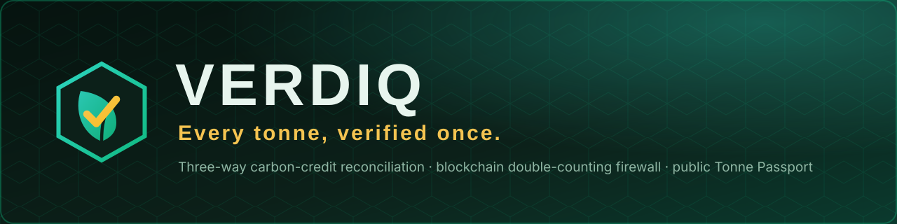
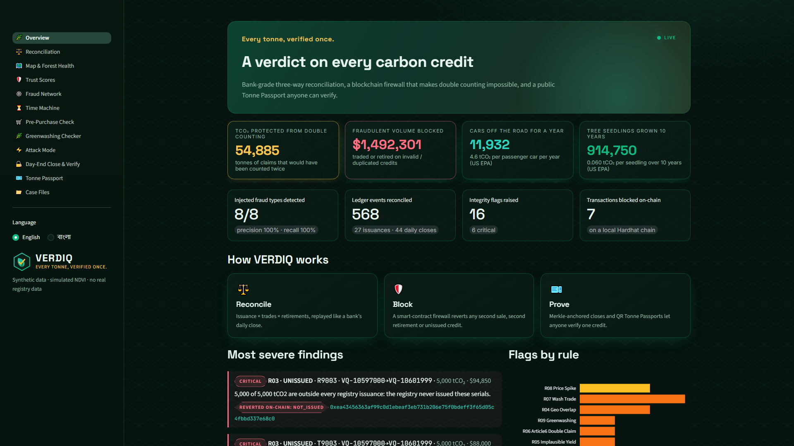
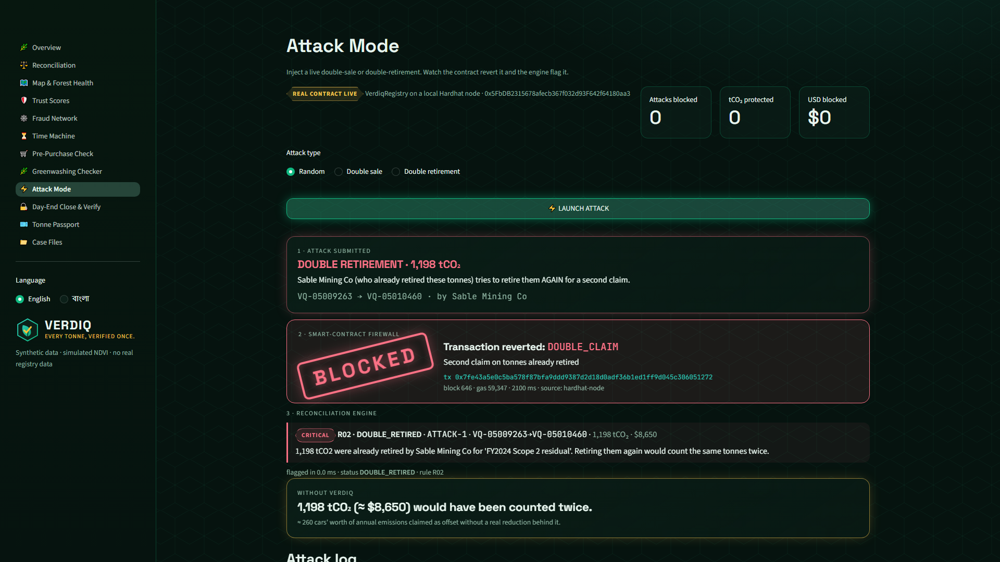
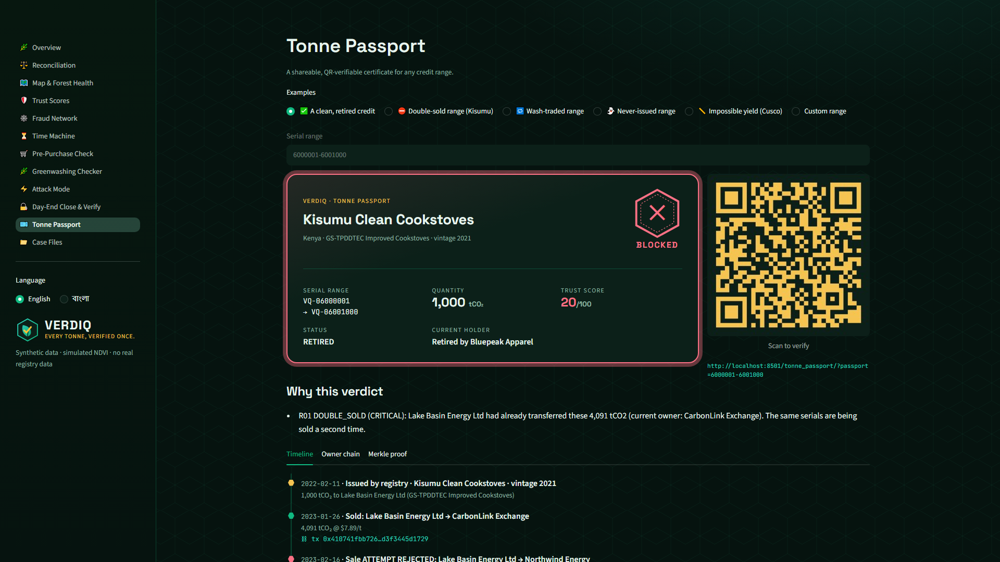
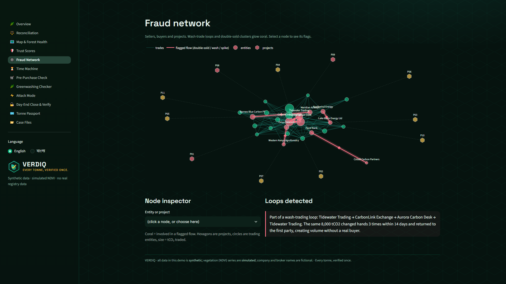
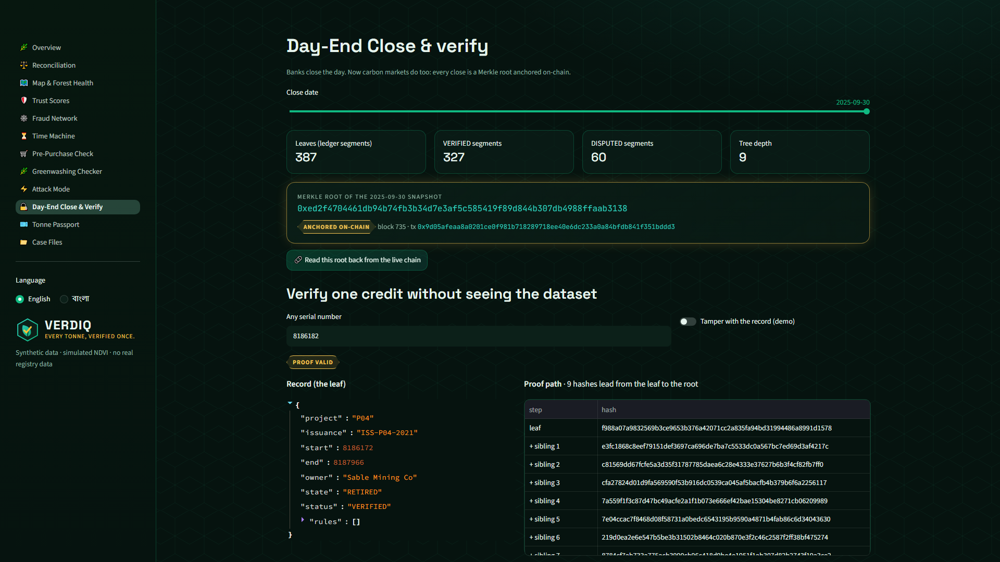
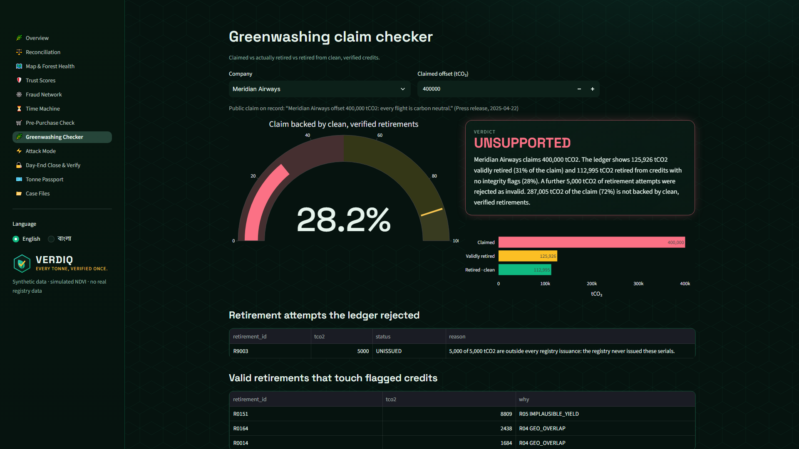
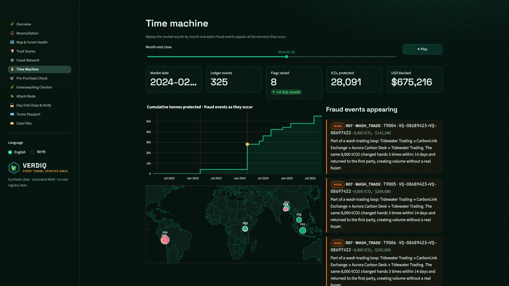
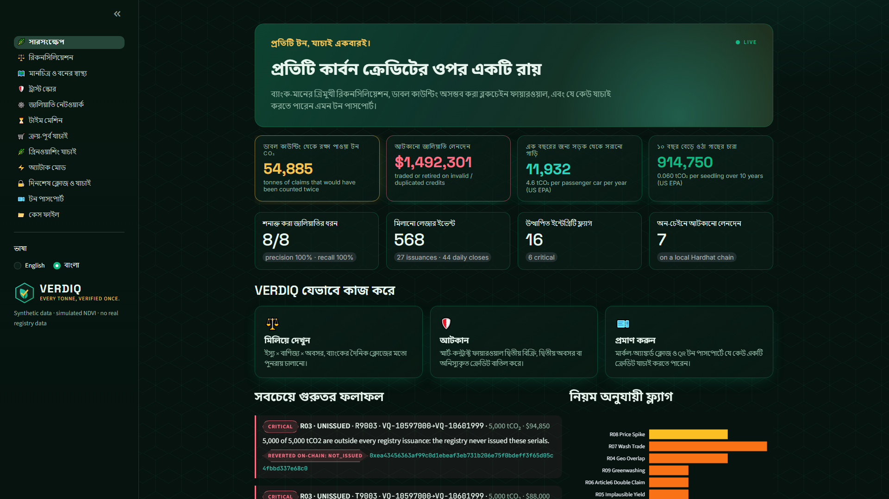
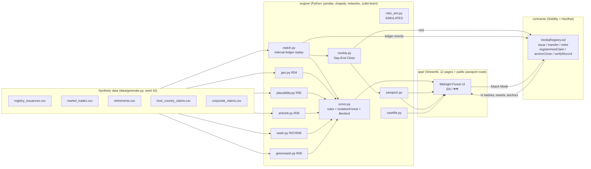

<p align="center"></p>

<p align="center">


</p>

# VERDIQ — *Every tonne, verified once.*

> Name = *verdict* + *verde* (green): **a verdict on every carbon credit.**

**VERDIQ is a bank-grade three-way reconciliation engine for carbon credits, with a blockchain firewall that makes double counting impossible and a public “Tonne Passport” anyone can verify.**

Built for the **IEEE ClimateChain Global Hackathon**, track **Carbon Markets & Emissions Transparency**.

> ⚠️ **Everything in this repository is synthetic.** Registry, trade and retirement data are generated by `data/generate.py` (fixed seed). Company, broker and developer names are fictional. The vegetation (NDVI-style) series are **simulated**, not satellite data. VERDIQ has no partnership with, and uses no data from, any real registry, company or government.

---

## The problem

Carbon credits fail on **trust**, not on arithmetic:

| Failure | What happens |
|---|---|
| Double selling | the same serial range is sold to two buyers |
| Double retirement | the same tonnes are retired twice, for two claims |
| Phantom credits | credits are traded or retired that were never issued |
| Double land claims | two projects are credited for the same forest |
| Impossible yields | sequestration claimed above what the land can physically hold |
| Article 6 double claim | the host country *and* the corporate buyer both count the same tonne |
| Wash trading | a ring of desks circulates the same credits to fake volume and price |
| Greenwashing | a company announces more offsets than it ever retired |

Banks solved the equivalent problem a century ago: **voucher vs ledger vs payment, reconciled at the daily close.** Carbon markets never did.

## The solution

VERDIQ applies banking reconciliation to carbon credits, and adds cryptographic proof:

```
 registry issuance ─┐
 market trades     ─┼─►  3-way reconciliation ─► integrity flags ─► Trust Score (0-100, with a plain-English "why")
 retirements       ─┘          │                       │
                               ▼                       ▼
                    Day-End Close snapshot      Smart-contract firewall (reverts the fraud)
                    ─► Merkle root ─► anchored on-chain ─► Tonne Passport + QR anyone can verify
```

### Screenshots (1080p, from the running dashboard)

| | |
|---|---|
|  **Overview** · animated impact counters, LIVE pulse |  **Attack Mode** · live attack, contract reverts, BLOCKED stamp |
|  **Tonne Passport** · gold certificate, QR, timeline, Merkle proof |  **Fraud Network** · wash loop and double-sold flows glow coral |
|  **Day-End Close** · Merkle proof for one credit |  **Greenwashing Checker** · claimed vs retired vs clean |
|  **Time Machine** · replay the market month by month |  **বাংলা / English** toggle |

More: [`docs/screenshots/`](docs/screenshots) (all 12 pages + the public verification page).

## Results

`data/ground_truth.json` records **11 injected fraud cases covering all 8 fraud types**. The engine is run blind against the ledger and scored:

| # | Injected fraud type | Rule | Detected |
|---|---|---|---|
| 1 | Same serial range sold to two buyers (+ phantom sale by a party that never held the credits) | R01 `DOUBLE_SOLD`, R10 `ORPHAN` | ✅ |
| 2 | Same serial range retired twice (+ second claimant) | R02 `DOUBLE_RETIRED` | ✅ |
| 3 | Credits traded **and** retired that were never issued | R03 `UNISSUED` | ✅ |
| 4 | Two projects with overlapping polygons (Sundarbans I / II, 31 % overlap) | R04 `GEO_OVERLAP` | ✅ |
| 5 | Claimed sequestration above the physical ceiling (173 vs 40 tCO₂/ha/yr) | R05 `IMPLAUSIBLE_YIELD` | ✅ |
| 6 | Host country + corporate buyer claim the same tonnes (Article 6) | R06 `ARTICLE6_DOUBLE_CLAIM` | ✅ |
| 7 | Wash-trading loop A→B→C→A (3 weeks, price ×2) + 12× price spike | R07 `WASH_TRADE`, R08 `PRICE_SPIKE` | ✅ |
| 8 | Greenwashing claim (350,000 tCO₂ claimed, 106,685 validly retired) | R09 `GREENWASHING` | ✅ |

**Detected 8/8 injected fraud types · precision 1.00 · recall 1.00** (16 flags, 0 false positives on 568 ledger events). A synthetic benchmark: it proves the rules work, not that real-world recall will be 100 %.

On the chain side, replaying the same 572 ledger transactions on a Hardhat network: **565 accepted, 7 reverted by the contract**, and the contract and the off-chain engine **agree on all 568 ledger events**. Behavioural fraud (wash loops, price spikes, geo overlap, impossible yield, greenwashing) cannot be seen by a contract that only tracks ownership, which is exactly why the engine exists alongside it.

## Features (A–K)

| | Feature | Where |
|---|---|---|
| A | **Day-End Close + Merkle proof**: every month-end snapshot is hashed into a Merkle tree and the root anchored on-chain; verify one credit without seeing the dataset. Python proofs are verified by the Solidity `verifyRecord`. | *Day-End Close & Verify*, `engine/merkle.py` |
| B | **Attack Mode**: inject a fresh random double-sale / double-retirement; the real contract reverts it, the engine flags it, coral alert + BLOCKED stamp | *Attack Mode* |
| C | **Tonne Passport**: gold-edged certificate, timeline, owner chain, trust score, Merkle status, **QR → public `?passport=` page** | *Tonne Passport* |
| D | **Trust Score** 0-100 per project and per range: rule flags + Isolation Forest + Benford's law, each with a plain-English “why” (offline, no paid API) | *Trust Scores*, `engine/score.py` |
| E | **Fraud Network Graph**: sellers/buyers/projects, coral glow on flagged flows, click a node for its flags | *Fraud Network* |
| F | **Time Machine**: month slider + Play; metrics, map, graph update and fraud events pop in when they occur | *Time Machine* |
| G | **Greenwashing Claim Checker**: claimed vs retired vs retired-from-clean credits, gauge + case summary | *Greenwashing Checker* |
| H | **Buyer Pre-Purchase Check + Portfolio Health**: SAFE / RISKY / BLOCKED per range, health score, “what to replace” from safer unsold inventory | *Pre-Purchase Check* |
| I | **Auditor Case File**: Markdown + PDF per flag (timeline, evidence, rule, blocking tx hash, Merkle proof). Optional Claude-written summary if `ANTHROPIC_API_KEY` is set, deterministic template otherwise | *Case Files*, `engine/casefile.py` |
| J | **Forest Health Simulator**: clearly-labelled *simulated* NDVI per project; flags claimed-growth-vs-vegetation-decline (P04) | *Map & Forest Health* |
| K | **Climate Impact Counter**: tonnes protected from double counting, fraudulent USD blocked, car/tree equivalents; animated | *Overview* |

Plus a **Bangla / English toggle** (sidebar) and the “Midnight Forest” theme (`app/theme.py`).

## Architecture



(also in [`docs/architecture.md`](docs/architecture.md))

**Serial ranges are intervals.** Both the engine (`engine/match.py`, a sorted interval map with split-on-write) and the contract (`VerdiqRegistry.sol`, a sorted segment array with binary search and splitting) use proper inclusive-interval overlap logic: partial overlaps, straddling ranges and fragmented ownership are all handled and unit-tested on both sides.

## Quick start

Prerequisites: Python ≥ 3.10, Node ≥ 18 (for the contract; optional, the app falls back to a Python mirror of the contract rules).

```bash
make setup      # pip install -r requirements.txt && npm install
make data       # generate synthetic data + run the engine
make test       # 24 pytest tests + 13 Hardhat contract tests
make replay     # replay all 572 txs on an in-process Hardhat chain, anchor 44 closes
make run        # dashboard on http://localhost:8501
```

No `make` (Windows)? Every target is `python verdiq.py <setup|data|test|replay|chain|run|shots|all>`.

Optional extras:

* `make chain` boots a persistent local Hardhat node and replays the ledger on it. **Attack Mode does this automatically on first use** (≈ 30-60 s once), then every attack takes ~3 s against the real contract.
* `ANTHROPIC_API_KEY=…` enables a Claude-written narrative in Case Files. Nothing needs a key: the template fallback is the default.
* `VERDIQ_PUBLIC_URL=https://your-host` sets the base URL encoded in Passport QR codes (defaults to the URL you opened the app on).
* `python -m playwright install chromium && python scripts/smoke.py --shots` re-captures the screenshots and smoke-tests every page.

### Repository layout

```
verdiq/
  data/        generate.py, ground_truth.json, *.csv         (synthetic)
  engine/      match, geo, plausibility, article6, wash, score, merkle, greenwash, ndvi_sim, passport, casefile, chain, pipeline
  contracts/   VerdiqRegistry.sol
  test/        VerdiqRegistry.test.js                          (Hardhat)
  tests/       test_engine.py, test_features.py                (pytest)
  scripts/     replay.js, attack.js, onchain.js, smoke.py
  app/         streamlit_app.py, theme.py, i18n.py, pages/*.py
  docs/        architecture.md, demo_script.md, devpost_description.md, DECISIONS.md, screenshots/
```

## Track alignment: Carbon Markets & Emissions Transparency

* **Emissions transparency**: every credit range gets a public, QR-verifiable passport with its full history; every flag carries a rule id, severity, evidence rows and plain-language reason; every day's market state is a Merkle root on a ledger nobody can edit afterwards.
* **Carbon-market integrity**: the three integrity failures of the voluntary market (double selling, double retiring, double claiming with host countries) are *blocked at the transaction*, not discovered a year later.
* **Climate impact**: each tonne that is not counted twice is a tonne of real mitigation that the climate system actually needs to happen. The Impact Counter quantifies it (conversion factors below).
* **Practical usefulness**: three audiences, one engine: *registries/regulators* (Day-End Close, case files), *buyers* (pre-purchase check, passport), *civil society & journalists* (greenwashing checker, public passports). Bangla UI because the first host country in the demo, Bangladesh, is among the most climate-exposed.

## Scalability

Real registries (e.g. Verra, Gold Standard) publish serial-level issuance, transfer and retirement data. `engine/` only needs three tables with `serial_start / serial_end / actor / date`, the schema of `data/*.csv`, so ingestion is a column-mapping exercise. The interval ledger is O(log n) per event and the Merkle close is O(n) per snapshot. For on-chain scale, the demo contract's sorted array should be replaced by an interval tree or lot-based accounting, and the hot path (ownership check) should be moved to an L2; the Merkle anchoring design already scales independently of the number of credits (one 32-byte root per day).

## Assumptions, conversion factors, limitations

* **Equivalents**: 1 passenger car ≈ **4.6 tCO₂ / year** and 1 urban tree seedling grown 10 years ≈ **0.060 tCO₂** (US EPA greenhouse-gas equivalencies). Used only for the Impact Counter.
* **Physical-plausibility ceilings** (`engine/plausibility.py`, documented there): mangrove 25, REDD+ 30, ARR 40, rice-methane 8 tCO₂e/ha/yr. Order-of-magnitude upper bounds, deliberately generous so honest projects never trip them; not authoritative standards. Cookstoves are not area-based and are checked by the other rules.
* **“Protected tonnes / USD blocked”** = tonnes and market value of ledger events and host claims the engine flags (and the contract rejects). Retirements are valued at the project median price.
* **Simulated NDVI**: deterministic synthetic series; P04 is *generated* to decline so the detector has something to find.
* **Benford's law** on ~40 trades per project is a screening hint, never a flag by itself; it only adjusts a score when a project deviates more than the portfolio median.
* **Limits**: single-currency prices; no real KYC identity (parties are deterministic addresses derived from names); the contract is a demo (O(n) segment shifts, no upgradeability, a single registry authority); Sepolia deployment was not done (local Hardhat only); recall 100 % is on injected, rule-shaped fraud.
* **No external services are required**: no API keys, no paid APIs; fonts and map tiles are loaded from public CDNs when online, and the app degrades gracefully offline.

## License

MIT, see [LICENSE](LICENSE).
