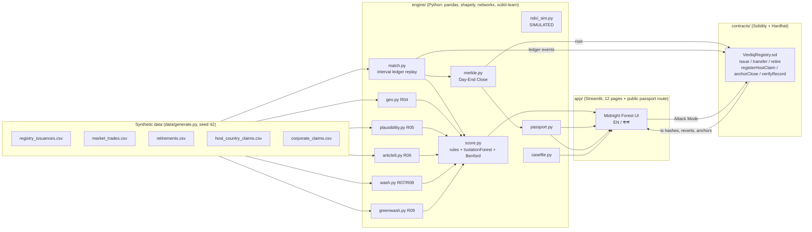

# VERDIQ architecture

## Data flow

1. `data/generate.py` writes five CSVs + `ground_truth.json` (seed 42).
2. `engine/pipeline.py` replays issuance → trades → retirements chronologically on an interval ledger, runs the geo / plausibility / Article 6 / wash / price / greenwashing rules, scores trust, and builds a Merkle Day-End Close at every month end (`data/out/`).
3. `scripts/replay.js` replays the same ordered events against `VerdiqRegistry.sol` (parties are impersonated deterministic addresses), records reverts and tx hashes, and anchors each close root (`data/out/chain_replay.json`).
4. The Streamlit app reads both and joins them: flags show the on-chain revert, passports show tx hashes and Merkle proofs, Attack Mode fires a fresh transaction at the live node (`scripts/attack.js`).

## Hash scheme (Python and Solidity agree)

`leaf = sha256(0x00 || canonical_json(record))`, `parent = sha256(0x01 || min(l,r) || max(l,r))`. A Python-generated proof is verified by `VerdiqRegistry.verifyRecord` in the Hardhat suite.
